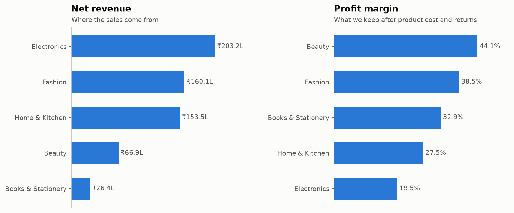
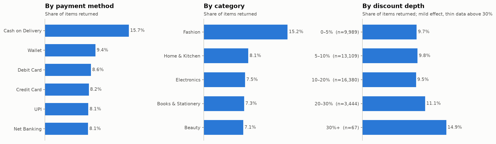
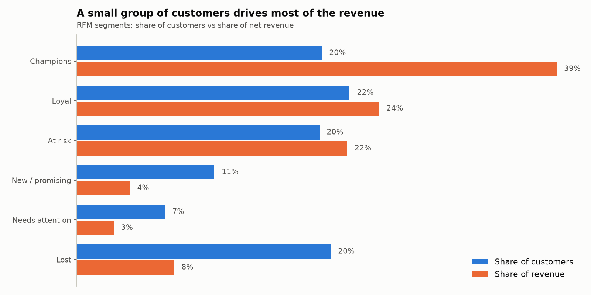
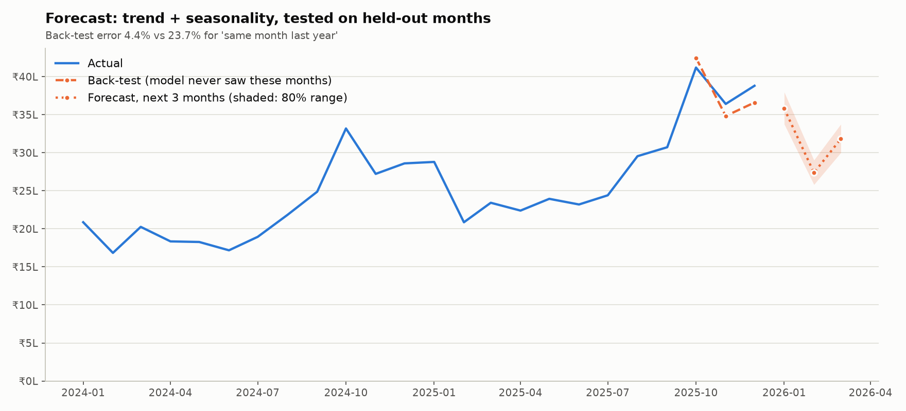
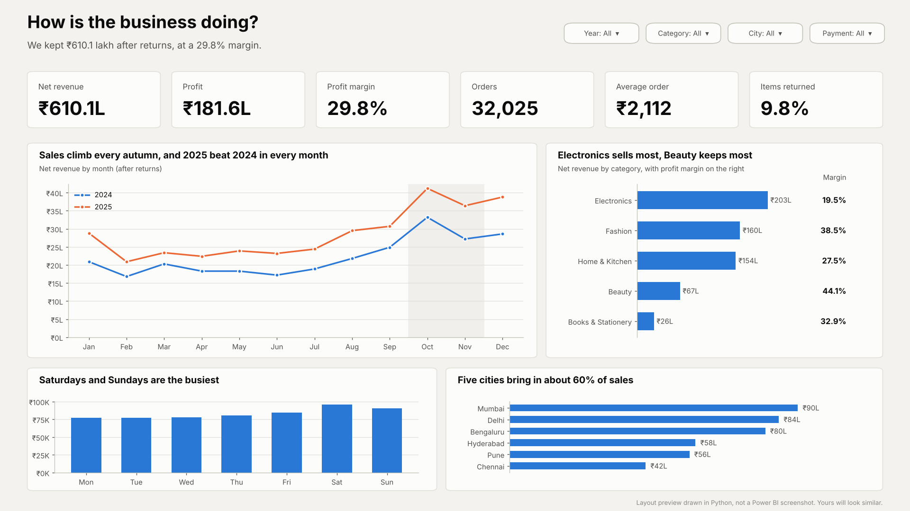
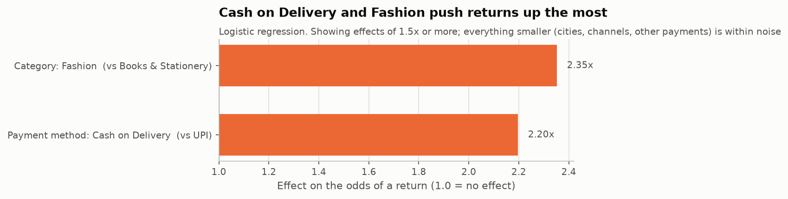

# E-commerce Sales Analysis: what's driving revenue, returns and repeat buyers?

**Author:** Tushar Jadhao
**Tools:** Python (pandas, NumPy, scikit-learn, Matplotlib), SQL (SQLite), Power BI
**Data:** 2 years of orders (Jan 2024 – Dec 2025) for an Indian online store. Synthetic, see the note below.

---

## Why I did this

I wanted a project that looks like the work an analyst actually gets handed: a messy orders table, a vague question ("how is the business doing, and what should we do next?"), and no answer key. So I picked the questions a business owner would really ask:

1. How much are we selling, and is it growing?
2. When do we sell the most, so we can plan stock and ad spend?
3. Which categories make money, as opposed to just making revenue?
4. Why do orders come back, and is it costing us?
5. Who are our best customers, and who are we about to lose?
6. What should we expect over the next three months?

## A note on the data (please read)

Real company data is private, so I generated the dataset myself (`generate_data.py`). I built in patterns you'd expect from an Indian shop: a Diwali spike, a Republic Day bump, weekend shopping, higher returns for Cash on Delivery and Fashion. Then I added the usual mess: duplicate rows, inconsistent labels, missing values.

That means the analysis can "find" things I planted. **The point of this project is the method, not the discovery**, and I'd say that in an interview too. The code runs the same way on a real orders export.

One thing I got wrong along the way is worth sharing: my first version of the data showed revenue doubling year over year and 78% of customers buying repeatedly. That looked too good to be true, so I dug in and found my customer sign-up logic was silently dropping most 2024 orders. I fixed the generator and re-ran everything. Checking whether numbers are *believable* before trusting them is a habit I want to keep.

## The data

| File | What's in it | Size |
|---|---|---|
| `data/orders.csv` | One row per item in an order: date, customer, product, quantity, discount, payment method, returned (yes/no), delivery days | 43,161 rows |
| `data/customers.csv` | City, age, gender, sign-up date, acquisition channel | 18,000 customers |
| `data/products.csv` | Category, list price, unit cost | 30 products, 5 categories |

## What I did

1. **Cleaned** the data. Removed 172 duplicate lines, standardised payment labels (`upi` → `UPI`, `COD` → `Cash on Delivery`), filled 614 missing delivery times and 543 missing ages with the median, trimmed stray spaces in city names.
2. **Defined the money clearly.** *Net revenue* = what customers paid, minus returned items (assumed fully refunded). *Profit* = net revenue minus product cost.
3. **Explored** sales by month, weekday, city, category and product.
4. **Dug into returns** by payment method, category and discount depth.
5. **Segmented customers** with RFM (Recency, Frequency, Monetary) and tracked **cohort retention**.
6. **Forecasted** the next three months with a trend + seasonality model, and **tested it on months it hadn't seen** before trusting it.

## What I found

**The business**

- Net revenue of about **₹6.1 crore** and profit of about **₹1.8 crore** (29.8% margin) across 32,025 orders and 12,519 buying customers.
- Average order value is about **₹2,112**.
- Revenue grew **29%**, from ₹2.66 crore in 2024 to ₹3.44 crore in 2025.

**When people buy**

- **October is the big one.** October 2025 hit ₹41.2 lakh, about 1.7× a typical Jan–Sep month. October and November together bring in about 23% of the year's revenue, in both years.
- Weekends bring in about **18% more** per day than weekdays. Saturday is the best day.

**What makes money**



- **Electronics sells the most (₹203 lakh) but keeps the least (19.5% margin).**
- **Beauty is the opposite:** a 44% margin on a small base (₹67 lakh).
- **Fashion is the quiet star:** ₹62 lakh profit, the most of any category, despite the highest return rate.
- Top seller by revenue is the **Smartwatch** (₹70 lakh). Top by profit is **Sneakers** (₹20 lakh).

**Why things come back**



- About **10% of items** are returned, roughly ₹66 lakh refunded.
- **Cash on Delivery returns 15.7%** of items vs about 8% for UPI and cards.
- **Fashion returns 15.2%** vs 7–8% for everything else. The two together are the worst case: **Fashion bought with COD comes back 20% of the time.**
- Deep discounts (30%+) show a higher return rate (14.9%), but that's only 67 items, so I treat it as a hint, not a finding.
- Honest sizing: if COD Fashion orders returned at the rate of prepaid Fashion orders, I'd recover only about **₹2.5 lakh**. Worth doing, but not a game-changer on its own.

**Who our customers are**



- **Champions are 20% of customers but 39% of revenue.** The top 10% of customers account for about 34% of revenue.
- **"At risk" customers (20% of the base) still bring in 22% of revenue.** They used to buy often and have gone quiet. This is the most valuable group to win back.
- About 61% of buyers ordered more than once (high for real e-commerce; a side effect of synthetic data).
- Cohort retention is fairly flat at roughly 10–13% of a cohort ordering in any given later month, so there's no sharp early drop-off in this data.

**What's coming**



- On the three months I held back (Oct–Dec 2025), the model was off by **4.4%** on average. The simple "same month as last year" guess was off by **23.7%**, because it ignores growth.
- Forecast for early 2026: **Jan ≈ ₹35.8 lakh, Feb ≈ ₹27.4 lakh, Mar ≈ ₹31.8 lakh.** Treat the shaded range as optimistic: it's based on only 24 months of history.

## What I'd recommend

1. **Plan around October.** Build inventory and ad budget ahead of the festive peak, and expect a smaller bump in January.
2. **Judge categories on profit, not revenue.** Test whether Beauty can grow without losing its margin, and look at whether Electronics pricing leaves room.
3. **Attack Fashion returns at the source:** better size guides and photos first, then a small nudge toward prepaid payment.
4. **Run a win-back campaign for "At risk" customers** before they slide into "Lost."
5. **Be cautious with deep discounts.** The evidence says they might raise returns, but I'd test it properly before changing policy.

## The SQL side

I redid the core of the analysis in SQL, partly because analysts live in SQL and partly as a cross-check. If two different tools give the same answer, I trust it more.

- `sql/02_clean_and_model.sql` does the cleaning inside the database (dedupe with `ROW_NUMBER`, standardise labels, fill blanks with flags) and builds reusable views.
- `sql/03_analysis_queries.sql` has **17 business questions**, each opening with a plain-English "why does this matter". They cover window functions (`LAG`, `RANK`, `ROW_NUMBER ... PARTITION BY`), CTEs, conditional aggregation, RFM scoring and cohort retention.
- **SQL and Python agree.** I compared revenue, profit, margins, return rates, city shares, cohort retention and every RFM segment count, and they match. The RFM one needed care: customers with identical behaviour have to share a rank, or ties get split into different segments by accident.

Full question list and a dialect cheat sheet (MySQL, PostgreSQL, SQL Server) are in [`sql/README.md`](sql/README.md).

## The Power BI dashboard

Four pages, each answering one question a manager would ask, with headlines that say what to notice:

| Page | Question | Centrepiece |
|---|---|---|
| 1 | How is the business doing? | KPI cards, 2024 vs 2025 monthly line |
| 2 | What sells, and what actually pays? | Revenue vs margin scatter by product |
| 3 | Why do orders come back? | Payment method by category heatmap |
| 4 | Who are our customers? | RFM segments, cohort retention, win-back list |



*That image is a layout preview drawn in Python, not a Power BI screenshot.*

The data is shaped as a star schema (one fact table of items sold, plus customer, product and date tables), which is what keeps Power BI filters fast and the measures simple. All measures are written in DAX in `powerbi/measures.dax`, and `powerbi/BUILD_GUIDE.md` walks through building the pages step by step.

Two choices worth mentioning: money columns stay raw in the data and **net revenue, profit and return rate are DAX measures**, so they respond to whatever the viewer filters. And the customer segments are a snapshot as of the last day of data, so they don't change with the date slicer. The dashboard says so on the page.

*(My own Power BI screenshots go in `powerbi/screenshots/`.)*

## Machine learning: which orders will come back?

After finding that Cash on Delivery and Fashion drive returns, I asked whether a model could flag risky orders before they ship. I trained a logistic regression on orders up to June 2025, using only information known at order time, and tested it on the newest six months.

- It separates risky from safe orders: the **riskiest 10% come back about 19% of the time, the safest 10% about 6%**.
- Fashion and Cash on Delivery each roughly **double the odds** of a return. City, channel and age made no reliable difference.
- The honest part: a **simple two-line rule does almost as well** (AUC 0.63 vs 0.63), and the model is already at the best score this synthetic data allows, because I generated returns as random draws.



Full write-up, charts and limits are in [`ml/README.md`](ml/README.md). Run it with `python ml/return_risk_model.py`.

## Limitations (what I'd say out loud)

- The data is synthetic, so findings reflect the patterns I built in.
- Profit ignores ad spend, shipping cost and return logistics, so real margins would be lower.
- Returns are treated as fully refunded and restocked.
- The forecast uses only two years of history; one more year would make the seasonal pattern far more reliable.
- Everything here is correlation. For example, I can't claim COD *causes* returns without an experiment.

## What I'd do next

- Test the "prepaid nudge" with an A/B experiment instead of guessing.
- Add a customer churn model (predict who goes quiet) using the RFM features.
- Refresh the dashboard from a live database instead of CSV files.

## Run it yourself

```bash
pip install -r requirements.txt
python3 generate_data.py   # creates data/*.csv (about 5 seconds)
python3 analysis.py        # creates outputs/ (charts, tables, key_findings.json)
python3 build_db.py        # builds ecommerce.db, runs the 17 SQL queries, exports the Power BI tables
python3 ml/return_risk_model.py   # trains the return-risk model, saves charts to ml/outputs/
python3 powerbi/make_preview.py   # optional: redraws the page 1 layout preview
```

On Windows, type `python` instead of `python3`.

Every number quoted above is written to `outputs/key_findings.json` when you run the analysis, and the same figures come out of the SQL queries in `sql/results/`. Run the scripts in this order.

## Project layout

```
ecommerce-sales-analysis/
├── data/                  orders.csv, customers.csv, products.csv
├── outputs/               7 charts, key_findings.json, tables/
├── sql/                   01 tables, 02 clean + views, 03 queries, 04 Power BI views, results/
├── powerbi/               data/ (model tables), measures.dax, theme.json, BUILD_GUIDE.md, preview
├── ml/                    return-risk model, charts, write-up and interview Q&A
├── generate_data.py       builds the dataset (seeded, reproducible)
├── analysis.py            cleaning, EDA, RFM, cohorts, forecast (Python)
├── build_db.py            builds the SQL database and runs the queries
├── INTERVIEW_GUIDE.md     how to talk about this project
└── requirements.txt
```
